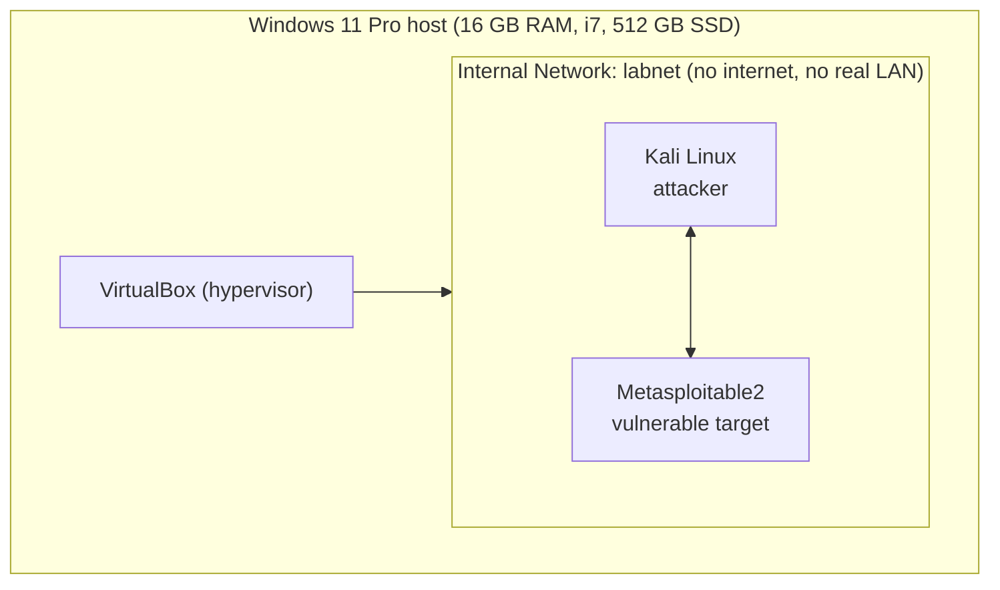

# Lab 01: Building My Home Security Lab

**Date started:** 1 November 2026
**Goal:** Build an isolated virtual lab where I can safely practice attacking and defending, as the foundation for a SOC (blue team) career that grows into red team skills.
**Status:** In progress. This write-up is updated as each step is completed.

---

## 1. Host machine

| Component | Spec |
|---|---|
| Operating system | Windows 11 Pro |
| Processor | 11th Gen Intel Core i7-1185G7 @ 3.00 GHz |
| RAM | 16 GB |
| Storage | 512 GB SSD |

This machine is the **host**. Every virtual machine in the lab is a **guest** running inside it.

## 2. Resource plan

With 16 GB of RAM, Windows needs roughly 6-8 GB, which leaves about 8 GB for virtual machines. I will not run every VM at the same time.

| Virtual machine | Role | RAM | CPU cores | Status |
|---|---|---|---|---|
| Kali Linux | Attacker / analyst workstation | 4 GB | 2 | Download in progress |
| Metasploitable2 | Deliberately vulnerable target | 1 GB | 1 | Planned |
| Windows VM | Realistic target for logs and detections | TBD | TBD | Planned (later) |
| Wazuh | SIEM / detection (blue team) | TBD | TBD | Planned (later) |

## 3. Lab diagram

The internal network means the two guests can talk only to each other. Nothing from my real Wi-Fi can reach the vulnerable machine, and nothing I run from Kali can leave the lab.

## 4. Setup log

| Step | Result |
|---|---|
| Confirmed hardware virtualization is enabled (Task Manager → Performance → CPU) | Enabled |
| Ran a full Microsoft Defender scan on the host before building the lab | No threats found |
| Installed VirtualBox | Done |
| Downloaded the pre-built Kali Linux VirtualBox image | In progress |
| Imported Kali and set RAM/CPU | Not yet |
| Downloaded and imported Metasploitable2 | Not yet |
| Put both machines on one Internal Network | Not yet |
| First `ping` from Kali to Metasploitable2 | Not yet |

## 5. Errors and fixes

> The struggle is the portfolio. Every error goes here, with the exact message and what fixed it.

| Date | What happened | Exact error | How I fixed it |
|---|---|---|---|
| | | | |

## 6. Safety rules I follow

1. **Metasploitable2 only ever runs on an Internal Network.** Never Bridged, never NAT. It is deliberately full of vulnerabilities, so it must not be reachable from a real network.
2. **I only attack machines I own or have written permission to test.** Unauthorized access is a crime under Nigeria's Cybercrimes Act, whatever the intent.
3. **I keep the host clean and updated.** The VM boundary is strong but not perfect, so the host is part of the defense.
4. **I take a snapshot of each VM once it works,** so I can roll back after breaking something.

## 7. What I learned so far

- A virtual machine is a complete computer that exists as software inside the host. VirtualBox is the hypervisor that divides the real RAM, CPU and storage between the guests.
- Isolation works in both directions. It protects the lab from the outside world, and it protects the outside world from my own scans and attacks.
- Network segmentation is not just theory. The Internal Network is the same principle I studied for stopping Lateral Movement, applied to my own lab.

## 8. Next steps

- [ ] Import Kali and boot it for the first time
- [ ] Run `pwd`, `ls` and `cd /var/log` in a real terminal
- [ ] Add Metasploitable2 and connect both machines on `labnet`
- [ ] Get the first successful `ping` between them
- [ ] Take a snapshot of each machine
- [ ] Write up Lab 02: first Nmap scan from Kali against Metasploitable2

